# Med Record: Product Teardown, Architecture & Implementation Specification

**Product Name:** Med Record (سجلي الطبي)  
**Target:** Egyptian & Regional Families (Arabic-first, RTL, Mobile-First PWA)  
**Core Purpose:** Track personal and children's health, manage medical records/scans, track child growth/vaccines, and generate a 1–2 page Doctor Report (PDF + secure expiring link).

---

## 1. Competitive Product Teardown & Reverse Engineering

We conducted a deep product and architecture teardown across 8 leading regional and global health platforms to identify what to copy, what to improve, and what to skip.

```
                    ┌────────────────────────────────────────────────────────┐
                    │               BENCHMARK PLATFORMS                      │
                    ├───────────────────────────┬────────────────────────────┤
                    │   Egyptian / Regional     │           Global           │
                    ├───────────────────────────┼────────────────────────────┤
                    │ • Vezeeta (Booking/Rx)    │ • Apple Health (FHIR/IPS)  │
                    │ • Chefaa (Chronic/Refills)│ • Google Health Connect    │
                    │ • Altibbi (Consults/Tele) │ • Medisafe (Adherence)     │
                    │ • Okadoc (Coordination)   │ • MyChart (Patient Portal) │
                    └───────────────────────────┴────────────────────────────┘
```

---

### 1.1 Egyptian & Regional Products

#### 1. Vezeeta (vezeeta.com)
* **Core Value & Features:** Marketplace for physician booking, polyclinic appointments, diagnostic lab bookings, and teleconsultations. Stores past prescriptions and doctor visit history.
* **Onboarding & UX:** Phone number + OTP onboarding. Search by specialty, area, and insurance provider.
* **Likely Data Model:**
  * `DoctorProfile` (specialty, clinic_locations, fees, rating)
  * `Appointment` (patient_id, doctor_id, timeslot, status, payment_status)
  * `Prescription` (appointment_id, doctor_id, medication_items[], notes, image_url)
* **What to COPY:**
  * Clean, Egyptian-dialect-aware specialty taxonomy (أطفال وحديثي ولادة، باطنة، تغذية علاجية، أنف وأذن، قلب وأوعية دموية).
  * Quick summary card for past doctor visits with clear doctor name, date, and diagnosis summary.
* **What to IMPROVE:**
  * Vezeeta prescriptions are often static images uploaded by the clinic or scanned paper; they lack structured medication tracking (e.g. active dose, duration countdown, interaction check).
  * No trend charting or longitudinal health metrics across visits.
* **What to SKIP:**
  * Doctor booking marketplace, payment gateway, insurance claims, doctor advertising.

---

#### 2. Chefaa (chefaa.com)
* **Core Value & Features:** Chronic medication management and scheduled monthly prescription refills delivered to patient homes across Egypt.
* **Onboarding & UX:** Prescription image scan/upload, chronic illness selection (hypertension, diabetes, thyroid), recurring delivery interval (e.g. every 30 days).
* **Likely Data Model:**
  * `ChronicPatientProfile` (user_id, delivery_address, chronic_conditions[])
  * `Prescription` (user_id, scan_url, status: verified/pending, verified_by_pharmacist_id)
  * `MedicationItem` (prescription_id, brand_name, dosage, frequency, quantity, package_size)
  * `RefillSchedule` (user_id, prescription_id, interval_days, next_refill_date, auto_order_enabled)
* **What to COPY:**
  * The focus on chronic illness medication regimes with daily dosage instructions and refill timelines.
  * Simple prescription photo capture with manual confirmation fallback.
* **What to IMPROVE:**
  * Chefaa is an e-commerce pharmacy app; it does not connect medication adherence to clinical outcomes (e.g., did taking antihypertensive medication lower blood pressure over the last 30 days?).
* **What to SKIP:**
  * Pharmacy logistics, payment processing, shopping cart, courier dispatch.

---

#### 3. Altibbi (altibbi.com)
* **Core Value & Features:** Arabic medical consultations (telehealth Q&A, chat, voice calls) and an extensive Arabic medical knowledge base.
* **Onboarding & UX:** Symptom-first navigation ("Ask a Doctor"), questionnaire asking age, sex, duration of complaint, and previous medical history.
* **Likely Data Model:**
  * `MedicalQuestion` (user_id, age, sex, complaint, attachments[], urgency)
  * `ConsultationResponse` (question_id, doctor_id, clinical_advice, suggested_tests[], timestamp)
  * `MedicalArticle` (ICD_category, slug, author_doctor_id, verified_at)
* **What to COPY:**
  * Clear, reassuring Arabic clinical phrasing that respects regional terminology without overwhelming patients with obscure medical jargon.
  * Structured intake summary: Age, Sex, Chief Complaint, Duration, Current Medications, Allergies.
* **What to IMPROVE:**
  * Altibbi consultations remain isolated threads rather than building a unified, longitudinal family health record.
* **What to SKIP:**
  * Content marketing, paywalled teleconsultation minutes, doctor marketplace.

---

#### 4. Okadoc (okadoc.com)
* **Core Value & Features:** Medical appointment scheduling, instant calendar sync, reminders via SMS/WhatsApp, and secure document upload for clinic check-in.
* **Onboarding & UX:** Mobile-first, calendar-centric flow, multi-family member booking (booking on behalf of children or spouse).
* **Likely Data Model:**
  * `Account` (primary_user_id, phone, email)
  * `Dependent` (account_id, full_name, relationship: child/spouse/parent, dob, emirates_id/national_id)
  * `Document` (dependent_id, document_type: insurance/emirates_id/lab_report, s3_key, expiry_date)
* **What to COPY:**
  * Seamless dependent/child profile switching from the top navigation bar.
  * Clean document upload flow with document categorization (تقارير معملية، أشعة، روشتات، تقارير خروج).
* **What to IMPROVE:**
  * Okadoc is primarily a B2B2C scheduling tool; documents are uploaded for the clinic's benefit rather than synthesized into an actionable patient health summary.
* **What to SKIP:**
  * Hospital clinic management integrations (Cerner/Epic API bridge), calendar slot availability sync.

---

### 1.2 Global Health Products

#### 5. Apple Health (iOS Health)
* **Core Value & Features:** Comprehensive personal health repository. Integrates on-device sensor data with clinical records via HL7 FHIR (Clinical Health Records). Features trendline analytics, highlight cards, and secure sharing with family and healthcare providers.
* **Architecture & Standards:**
  * Uses HL7 FHIR STU3 / R4 payloads mapped internally to `HKClinicalRecord` and `HKCategorySample`.
  * Visual highlights (e.g., "Your resting heart rate was lower this week").
  * End-to-end encrypted sharing via public/private key pairs.
* **What to COPY:**
  * **Measurement Highlights & Reference Bands:** Showing normal vs abnormal ranges (e.g. Systolic < 120 green, 120-129 yellow, 130+ orange) directly on the trend chart.
  * **Health Highlights Feed:** A quick summary of recent changes rather than endless raw tables.
  * **Emergency Medical ID (هوية الطوارئ):** 1-tap accessible emergency screen showing blood type, emergency contacts, life-threatening allergies, and active medications.
* **What to IMPROVE:**
  * Apple Health is iOS-only and largely individual-focused; managing multiple young children with growth percentile curves and vaccination schedules requires third-party apps.
* **What to SKIP:**
  * Wearable Bluetooth sensor streaming (Apple Watch HKHealthStore background sync), gait metrics, audio exposure tracking.

---

#### 6. Google Health Connect (Android)
* **Core Value & Features:** On-device Android repository providing a unified API for fitness and health apps, with fine-grained per-data-type read/write permission scopes.
* **Architecture & Standards:**
  * Schema grouped into 6 clinical/fitness buckets: Activity, Body Measurements, Cycle Tracking, Nutrition, Sleep, Vitals.
  * Strongly typed data schemas (e.g., `BloodPressureRecord` has `systolic`, `diastolic`, `bodyPosition`, `measurementLocation`).
* **What to COPY:**
  * Strict schema typing for vitals with validated units (mmHg, bpm, mg/dL, kg, cm, %).
  * Granular data export and complete local deletion ("Delete all measurements of type X").
* **What to IMPROVE:**
  * Health Connect has no UI of its own (it is an underlying Android system service) and lacks document storage or clinical report synthesis.
* **What to SKIP:**
  * Android OS-level service bindings and fitness step/calorie aggregation.

---

#### 7. Medisafe (medisafe.com)
* **Core Value & Features:** The gold standard in medication schedule adherence. Multi-schedule pill reminders, refill alerts, medication interaction checking, and "Medfriend" caregiver alerts.
* **Onboarding & UX:** 3-step medication entry: Name → Shape/Color → Dose & Frequency (Daily, Specific days, As needed).
* **Likely Data Model:**
  * `Medication` (id, user_id, brand_name, generic_name, strength, form: pill/syrup/drops/injection)
  * `DoseSchedule` (medication_id, time_of_day, dose_amount, with_food: before/after/with)
  * `AdherenceLog` (dose_schedule_id, scheduled_at, taken_at, status: taken/skipped/snoozed)
* **What to COPY:**
  * Flexible dosage scheduling (مرة يومياً مع الإفطار، مرتين يومياً كل ١٢ ساعة، عند اللزوم).
  * Medication status distinction: Active (حالي), Paused (موقوف مؤقتاً), and Discontinued/Past (منتهي).
* **What to IMPROVE:**
  * Medisafe can be overly notification-heavy and lacks a unified medical document vault or doctor visit journal.
* **What to SKIP:**
  * Complex gamification points, social sharing, pharmaceutical ad placements.

---

#### 8. Epic MyChart (mychart.org)
* **Core Value & Features:** The dominant enterprise patient portal worldwide. Provides After Visit Summaries (AVS), structured laboratory results with standard reference ranges, proxy access for pediatric dependents, and clinical summary PDF exports.
* **Architecture & Standards:**
  * Direct HL7 FHIR provider (Patient, Observation, DiagnosticReport, DocumentReference, Immunization).
  * Explicit Proxy Access model: Parent granted full access to Child (< 12 years), restricted access for adolescents (12–17 years depending on jurisdiction).
  * After Visit Summary (AVS) PDF format: 1–2 page clean document given to patient after each consultation.
* **What to COPY:**
  * **The 1–2 Page Clinical Summary layout (AVS pattern):** The exact mental model for our Doctor Report Generator.
  * **Lab Result Presentation:** Analyte name, observed value, unit, reference range flag (Normal / High / Low), and collection date.
  * **Child Proxy Profile Architecture:** Clean separation of medical identity while managed by a single authenticated guardian account.
* **What to IMPROVE:**
  * MyChart's enterprise UI is clunky, slow, desktop-heavy, and notoriously difficult to navigate on mobile.
* **What to SKIP:**
  * Insurance billing statements, hospital inpatient telemetry, physician internal scheduling.

---

## 2. Comparative Teardown Matrix

| Product | Target Persona | Child/Family Profiles | Clinical Document Vault | Measurements & Trends | Medication Adherence | Doctor Summary Report | Open Standards (FHIR/LOINC) | Privacy & Data Control |
|---|---|---|---|---|---|---|---|---|
| **Vezeeta** | Patient booking | Multi-patient booking | Prescription photos only | ❌ None | ❌ Static list | ❌ None | ❌ Proprietary | Basic account delete |
| **Chefaa** | Chronic patients | Dependent delivery | Prescriptions only | ❌ None | Recurring refills | ❌ None | ❌ Proprietary | Standard e-commerce |
| **Altibbi** | Telehealth seekers | Family questions | Image attachments | ❌ None | In consultation | ❌ Chat export only | ❌ Proprietary | Session-based |
| **Okadoc** | Clinic patients | Family switcher | Basic upload | ❌ None | ❌ None | ❌ None | ❌ Proprietary | Account-based |
| **Apple Health** | iOS consumer | ❌ Individual only | Via FHIR integration | Best-in-class | Native reminders | Basic XML/PDF | Native FHIR R4 | E2E encrypted on-device |
| **Google Health Connect** | Android ecosystem | ❌ Single user | ❌ None | Sensor sync | ❌ API only | ❌ None | Partial FHIR alignment | Granular OS permissions |
| **Medisafe** | Complex drug regimens | Caregiver (Medfriend) | ❌ None | ❌ None | Best-in-class | Adherence report PDF | ❌ Proprietary | Cloud account |
| **Epic MyChart** | Hospital patients | Proxy access for kids | Institutional records | Clinical lab charts | Active meds list | Best-in-class (AVS) | Full HL7 FHIR & LOINC | Enterprise HIPAA |
| **Med Record (Ours)** | **Egyptian Families** | **Native Parent + Kids** | **Private Vault + Tags** | **Vitals + WHO Growth** | **Active Regimens** | **1–2 Page PDF + Expiring Link** | **HL7 FHIR & LOINC Mapped** | **RLS + Signed URLs + Zero-Lockin** |

---

## 3. Open Standards Mapping (HL7 FHIR, LOINC, ICD-10, IPS)

To ensure Med Record is interoperable, robust, and future-proof, our internal data structures map 1:1 to open healthcare standards.

```
                      ┌────────────────────────────────────────┐
                      │    INTERNATIONAL PATIENT SUMMARY       │
                      │               (IPS)                    │
                      │         HL7 FHIR Document              │
                      └──────────────────┬─────────────────────┘
                                         │
     ┌──────────────────┬────────────────┼─────────────────┬──────────────────┐
     ▼                  ▼                ▼                 ▼                  ▼
┌──────────┐     ┌─────────────┐   ┌────────────┐    ┌───────────┐     ┌──────────────┐
│ Patient  │     │ Observation │   │ Medication │    │ Condition │     │ Diagnostic   │
│ (Family  │     │ (Vitals,    │   │ Statement  │    │ & Allergy │     │ Report &     │
│  Profile)│     │  WHO Growth)│   │ (Regimens) │    │ (History) │     │ DocumentRef  │
└──────────┘     └─────────────┘   └────────────┘    └───────────┘     └──────────────┘
```

### 3.1 HL7 FHIR Core Resources Mapping

| Med Record Entity | HL7 FHIR R4 Resource | Standard Coding / Vocabularies | Description |
|---|---|---|---|
| `family_members` | `Patient` | `administrative-gender`, ISO 8601 | Profile for self and each child (DOB, sex, blood type). |
| `guardianship` | `RelatedPerson` | `v3-RoleCode` (MTH: Mother, FTH: Father) | Relationship between authenticated user and child. |
| `measurements` (Vitals) | `Observation` (vital-signs) | LOINC, UCUM units | Blood pressure, heart rate, temperature, SpO2, blood glucose. |
| `growth_measurements` | `Observation` (body-metrics) | LOINC (weight, height, head circ) + WHO Growth Standards | Pediatric growth percentiles and Z-scores. |
| `medications` | `MedicationStatement` / `MedicationRequest` | RxNorm / Egyptian Drug Authority (EDA) ATC | Active and past drugs, strength, dosing, frequency. |
| `conditions` | `Condition` | ICD-10-CM / Plain Text | Chronic illnesses and clinical history. |
| `allergies` | `AllergyIntolerance` | SNOMED CT / Severity codes | Food, drug, and environmental allergies. |
| `vaccinations` | `Immunization` | CVX / Egyptian MOH Schedule | Vaccine sequence, dose, batch number, date. |
| `encounters` | `Encounter` | `v3-ActEncounterCode` (AMB: Ambulatory) | Past doctor consultations, specialty, diagnosis, notes. |
| `medical_documents` | `DocumentReference` | MIME-types, LOINC class codes | Lab PDFs, radiology scans, prescriptions, discharge letters. |
| `doctor_reports` | `Composition` / Bundle (IPS) | International Patient Summary (IPS) Profile | The structured bundle powering the 1–2 page Doctor Report. |

### 3.2 Standard LOINC Codes for Med Record Measurements

```
• 85354-9  Blood pressure panel with all children (Systolic & Diastolic)
   ├─ 8480-6   Systolic blood pressure (mmHg)
   └─ 8462-4   Diastolic blood pressure (mmHg)
• 8867-4   Heart rate / Pulse (beats/min)
• 2339-0   Glucose [Mass/volume] in Blood (mg/dL) - Fasting / Post-meal / Random
• 4548-4   Hemoglobin A1c / HbA1c in Blood (%)
• 29463-7  Body weight (kg)
• 8302-2   Body height / length (cm)
• 9843-4   Head occipital-frontal circumference (cm) [Pediatric]
• 59408-5  Oxygen saturation in Arterial blood by Pulse oximetry (%)
• 8310-5   Body temperature (°C)
```

---

## 4. Proposed Relational Data Model (ERD)

Below is the complete database schema engineered for Supabase Postgres with strict Row Level Security (RLS) and cryptographic tenant isolation.

```mermaid
erDiagram
    users ||--o{ family_members : "owns/manages"
    users ||--o{ audit_logs : "records"
    users ||--o{ report_shares : "creates"
    
    family_members ||--o{ emergency_contacts : "has"
    family_members ||--o{ conditions : "diagnosed_with"
    family_members ||--o{ allergies : "has_allergy"
    family_members ||--o{ measurements : "tracks"
    family_members ||--o{ growth_measurements : "pediatric_charts"
    family_members ||--o{ medications : "takes"
    family_members ||--o{ encounters : "visits"
    family_members ||--o{ vaccinations : "receives"
    family_members ||--o{ medical_documents : "vault"
    family_members ||--o{ doctor_reports : "compiles"

    medications ||--o{ medication_logs : "adherence"
    doctor_reports ||--o{ report_shares : "generates_link"

    family_members {
        uuid id PK
        uuid user_id FK
        text full_name
        text relationship "self | child | spouse | parent"
        date birth_date
        text sex "male | female"
        text blood_type "A+ | A- | B+ | B- | AB+ | AB- | O+ | O- | unknown"
        boolean is_primary
        text avatar_color
        timestamp created_at
        timestamp archived_at
    }

    measurements {
        uuid id PK
        uuid member_id FK
        text measurement_type "blood_pressure | blood_sugar | heart_rate | temperature | spo2 | weight | height"
        jsonb values "{systolic, diastolic} or {glucose, context: fasting/post_prandial/random} or {value}"
        text unit "mmHg | mg/dL | bpm | C | % | kg | cm"
        text loinc_code
        boolean is_abnormal
        text notes
        timestamp recorded_at
    }

    growth_measurements {
        uuid id PK
        uuid member_id FK
        numeric age_in_months
        numeric weight_kg
        numeric height_cm
        numeric head_circumference_cm
        numeric weight_for_age_percentile
        numeric height_for_age_percentile
        numeric head_circumference_percentile
        numeric bmi_for_age_percentile
        numeric weight_for_age_zscore
        numeric height_for_age_zscore
        timestamp recorded_at
    }

    medications {
        uuid id PK
        uuid member_id FK
        text name
        text dose
        text frequency
        text timing_notes
        date start_date
        date end_date
        text status "active | paused | completed"
        boolean reminder_enabled
        text reminder_time
        timestamp created_at
    }

    medical_documents {
        uuid id PK
        uuid member_id FK
        text title
        text document_type "lab_result | radiology | prescription | hospital_report | vaccination_card"
        text storage_path "encrypted private storage path"
        text file_name
        text file_type "application_pdf | image_jpeg | image_png"
        integer file_size_bytes
        date document_date
        text doctor_name
        text facility_name
        text[] tags
        text extracted_summary
        timestamp created_at
    }

    encounters {
        uuid id PK
        uuid member_id FK
        date visit_date
        text doctor_name
        text specialty
        text facility_name
        text chief_complaint
        text diagnosis
        text notes
        date follow_up_date
        timestamp created_at
    }

    vaccinations {
        uuid id PK
        uuid member_id FK
        text vaccine_name
        text target_disease
        integer dose_number
        date scheduled_date
        date administered_date
        text status "completed | pending | overdue"
        text batch_number
        text notes
        timestamp created_at
    }

    doctor_reports {
        uuid id PK
        uuid member_id FK
        text title
        date date_from
        date date_to
        jsonb included_sections "['vitals', 'meds', 'allergies', 'labs', 'visits']"
        jsonb snapshot_data "frozen FHIR IPS JSON snapshot"
        text summary_notes
        timestamp created_at
    }

    report_shares {
        uuid id PK
        uuid report_id FK
        text access_token "secure cryptographic random token"
        text pin_hash "optional 4-digit PIN for extra privacy"
        timestamp expires_at
        boolean is_revoked
        integer view_count
        timestamp last_viewed_at
    }
```



---

## 5. Prioritized Feature Roadmap (MVP vs. Later)

### Phase 1: MVP (Delivered in this plan)
1. **Bilingual Arabic-First UI / RTL:** Natural Egyptian Arabic medical phrasing with seamless English toggle.
2. **Multi-Profile Family Hub:** Parent profile + multiple children with distinct colors, avatars, DOB, and blood type.
3. **Rapid Measurement Logging (< 10 seconds):**
   - Adult Vitals: Blood pressure (Systolic/Diastolic), Heart Rate, Blood Sugar (Fasting / Post-meal / Random / HbA1c), SpO2, Temperature, Weight, Height.
   - Child Growth: Head circumference, Height, Weight.
4. **Interactive Trends & WHO Growth Curves:**
   - Normal reference bands (Green/Yellow/Red) for adult vitals.
   - WHO Growth Percentile curves (0–5 years and 5–19 years) for pediatric weight-for-age, height-for-age, and head circumference.
5. **Secure Medical Document Vault:**
   - Upload PDF and scans (JPEG/PNG).
   - Categorization: تحاليل طبية، أشعة وسونار، روشتات، تقارير مستشفى، كروت تطعيم.
   - Tagging, date, doctor, facility filters, and secure signed URLs (no public buckets).
6. **Medication Regimen Manager:**
   - Active vs. Paused vs. Past medications.
   - Strength, dose, frequency, and reminder schedule.
7. **Doctor Visits Journal:**
   - Date, doctor, specialty, diagnosis, notes, and follow-up alert date.
8. **Childhood Vaccination Tracker:**
   - Pre-populated with official Egyptian Ministry of Health mandatory childhood schedule (birth to 18 months).
   - Custom booster and private vaccine support (Rotavirus, Pneumococcal, Flu).
   - Due-date and overdue status badges.
9. **Doctor Report Generator (1–2 Page Summary):**
   - Custom profile, date range, and section picker.
   - Bilingual (Arabic/English) clean clinical A4 print/PDF layout.
   - Shareable read-only expiring web link with optional PIN and instant revoke.
10. **Emergency Quick Summary Card (بطاقة الطوارئ):**
    - High-contrast, 1-screen summary: Blood type, emergency contacts, active medications, life-threatening allergies, and chronic conditions.
11. **Data Sovereignty & Privacy:**
    - 1-click JSON and CSV full data export.
    - "Delete All My Data" (Hard erase of profile, measurements, and storage files).
    - Clear medical disclaimer: "أداة حفظ ومتابعة شخصية وليست بديلاً عن التشخيص الطبي".

### Phase 2: Post-MVP (Future Roadmap)
1. **Web Push Notification Engine:** Direct browser push notifications for medication dose times and vaccine milestones.
2. **Lab Result OCR / Smart Extraction:** Using Gemini 1.5 Flash multimodal to extract analyte numbers from lab test photos into structured measurements.
3. **Apple Health & Android Health Connect Sync:** Direct device sync via Capacitor or React Native companion wrapper.
4. **Multi-Guardian Co-Parenting:** Secure invitation allowing both parents to manage children's records simultaneously.

---

## 6. Proposed Technology Stack & Architecture Justification

```
┌────────────────────────────────────────────────────────────────────────┐
│                          MED RECORD ARCHITECTURE                       │
├────────────────────────────────────────────────────────────────────────┤
│ • UI Framework: Next.js 15 App Router + React 19 + TypeScript          │
│ • Styling & Design System: Tailwind CSS + Lucide Icons + shadcn/ui     │
│ • Typography: Google Fonts Cairo + Tajawal (Optimized Arabic glyphs)   │
│ • Data Visualization: Recharts (RTL-adapted, WHO reference overlays)   │
│ • Database & Auth: Supabase Postgres + RLS + GoTrue Auth               │
│ • Storage: Supabase Storage (Private bucket + Expiring Signed URLs)    │
│ • Clinical Reports: Browser Print CSS + High-Fidelity SVG/Canvas/PDF   │
│ • Offline / Mobile: PWA Manifest + Service Worker caching               │
│ • Data Standards: HL7 FHIR IPS JSON Schema Compliance                  │
└────────────────────────────────────────────────────────────────────────┘
```

* **Why Next.js App Router + TypeScript?**
  Leverages the current project's modern foundation, ensuring high performance, zero client-side payload for static layouts, and robust type safety across health entities.
* **Why Supabase Postgres + RLS?**
  Medical privacy requires that permission logic lives in the database kernel, not just in UI code. With Postgres Row Level Security, no user can ever query or read another family's health data even if an API route had a flaw.
* **Why Private Storage with Signed URLs?**
  Medical documents (lab reports, radiology scans) must **never** be accessible via public CDN URLs. Supabase private storage allows generating cryptographic signed URLs that expire after 10–15 minutes.
* **Why Cairo / Tajawal Fonts?**
  Medical reports printed in Arabic must maintain crisp, legibly differentiated numbers and letters. Cairo and Tajawal offer complete coverage for Arabic and Latin character sets, avoiding ugly browser font fallbacks during PDF printing.

---

## 7. Phased Implementation Plan

```
[Phase 1: Auth & Family Profiles]
       │
       ▼
[Phase 2: Measurements & Interactive WHO Charts]
       │
       ▼
[Phase 3: Secure Document Vault & Signed URLs]
       │
       ▼
[Phase 4: Medications & Doctor Visits Log]
       │
       ▼
[Phase 5: Egyptian MOH Vaccination Tracker]
       │
       ▼
[Phase 6: Doctor Report Generator (PDF & Expiring Link)]
       │
       ▼
[Phase 7: Emergency Card, Data Export & Verification]
```

### Phase 1: Database Migration, Auth & Family Profiles
* Write migration `supabase/migrations/20261027_med_record_schema.sql` creating all tables (`family_members`, `measurements`, `growth_measurements`, `medications`, `encounters`, `vaccinations`, `medical_documents`, `doctor_reports`, `report_shares`, `audit_logs`).
* Configure RLS policies (`auth.uid() = user_id`) on all tables with default deny.
* Build the Family Member Switcher component and Profile Management UI (add self, add child, birth date, blood type, allergies, chronic conditions).

### Phase 2: Rapid Measurements & Interactive WHO Charts
* Implement the < 10-second quick entry bottom-sheet / modal.
* Build measurement trend charts with normal-range background bands.
* Integrate WHO Child Growth Standards (LMS percentiles and Z-scores for 0–5y and 5–19y) for pediatric profiles.
* Add abnormal value badges (e.g., High Blood Pressure, Elevated Fasting Blood Sugar).

### Phase 3: Secure Document Vault
* Create private Supabase storage bucket `med-record-documents`.
* Implement drag-and-drop document upload with client-side file-type validation.
* Implement signed URL retrieval API route with automatic 15-minute token expiration.
* Build document list view with category filters (Labs, Radiology, Prescriptions, Hospital Reports), search, and tags.

### Phase 4: Medications & Doctor Visits Log
* Build Medication manager with Active / Paused / Completed statuses.
* Add dosage, frequency, and time-of-day options.
* Build Doctor Visits Log (specialty, doctor name, clinic/hospital, diagnosis, notes, follow-up date).

### Phase 5: Childhood Vaccination Tracker
* Seed official Egyptian Ministry of Health childhood immunization schedule.
* Calculate age in months and display due, completed, or overdue status.
* Allow logging vaccination date, batch number, and notes.

### Phase 6: Doctor Report Generator (PDF + Expiring Share Link)
* Build Doctor Report configuration modal: select member, date range (Last 3 months, 6 months, 1 year, All), and toggle sections.
* Render clean, professional A4 print layout in Arabic + English.
* Implement shareable read-only link generation with cryptographically random token, custom expiration (e.g. 24h, 48h, 7d), optional 4-digit PIN, and immediate revoke toggle.
* Implement public read-only report viewer page (`/share/[token]`).

### Phase 7: Emergency Card, Data Export & Privacy Hardening
* Build 1-screen high-contrast Emergency Quick Summary (`/emergency/[memberId]`).
* Implement 1-click JSON / CSV full health record export.
* Implement "Delete All My Data" flow with confirmation modal.
* Add audit logging for report views and exports.
* Write automated Vitest & Playwright tests covering RLS isolation and report generation.
