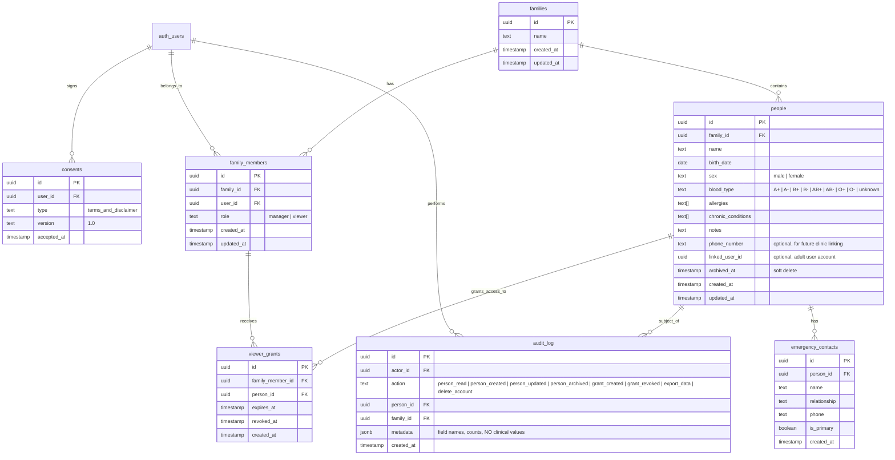

# Med: Phase 1 (Family Space Foundation) Implementation Plan

> **For agentic workers:** REQUIRED SUB-SKILL: Use superpowers:subagent-driven-development (recommended) or superpowers:executing-plans to implement this plan task-by-task. Steps use checkbox (`- [ ]`) syntax for tracking.

**Goal:** Build Phase 1 of Med: a dual-entry portal featuring an open-signup Arabic-first Family Space for tracking family/child health records and an invitation-only stub for healthcare organizations, underpinned by Postgres Row-Level Security, consent gating, and zero health data leakage in logs.

**Architecture:** Next.js 15 App Router with Supabase Auth, Postgres RLS, and private Storage. Single entry landing page branching into "مستخدم عادي" (Family Space) and "طرف في منظومة صحية" (Clinic Gateway invitation-only stub). Complete isolation between personal family data and future clinic schemas, with soft-deletes (`archived_at`), granular viewer grants, and strict audit logging.

**Tech Stack:** Next.js 15 (App Router, React 19, TypeScript), Tailwind CSS, Supabase (Postgres, Auth, Storage, RLS), Lucide Icons, Vitest, Playwright.

**Spec Reference:** User Phase 1 Prompt (`docs/PROJECT.md` reference architecture & Phase 1 Scope).

---

## Global Constraints

- **Arabic-first RTL by default:** `dir="rtl"` with natural Egyptian Arabic phrasing, plus instant English toggle.
- **Strict tenant and family isolation:** Zero cross-family data access via database-level RLS (`default deny`), never UI-only filtering.
- **Zero health data in application logs or audit logs:** `audit_log` records actions, actor, entity ID, and timestamp; never health values, diagnoses, or notes.
- **Soft deletion:** People records use `archived_at` instead of hard deletion.
- **Medical disclaimer:** Non-diagnostic disclaimer and explicit consent recorded on first login before accessing family data.
- **Clinic invitation-only isolation:** The clinic gateway has NO public registration; role selection is a routing stub and grants zero permissions.
- **Deterministic fake seed data only:** Realistic Egyptian sample data (1 adult: أحمد مصطفى, 2 children: سارة, ياسين); no real medical data.

---

## Review Focus

1. **Manager vs Viewer RLS boundary:** A viewer must only read people with active, unrevoked, unexpired grants; manager has full CRUD on own family only.
2. **Cross-family leakage prevention:** User in Family A attempting direct SQL or API query on Family B receives 0 rows / access denied.
3. **Consent gating enforcement:** Unconsented user is blocked from viewing or creating people until accepting the disclaimer.
4. **Clinic entry stub security:** Healthcare party role dropdown does not persist roles or grant any access; displays invitation-only notice.
5. **Data export and full deletion safety:** Data export produces clean JSON; "Delete all my data" requires explicit confirmation and cleans up all related records without leaving orphaned sensitive data.

---

## System Architecture & Data Model

### Data Model Diagram (Mermaid ERD)



---

## Complete Row Level Security (RLS) Policy List

### Helper Functions (Postgres SECURITY DEFINER)
1. `public.is_family_manager(f_id UUID) RETURNS BOOLEAN`: Checks if `auth.uid()` has `role = 'manager'` in `family_members` for `f_id`.
2. `public.is_family_member(f_id UUID) RETURNS BOOLEAN`: Checks if `auth.uid()` is present in `family_members` for `f_id`.
3. `public.has_active_viewer_grant(p_id UUID) RETURNS BOOLEAN`: Checks if `auth.uid()` has an active grant in `viewer_grants` (`expires_at > now() AND revoked_at IS NULL`).

### Table Policies
1. **`families`**
   - SELECT: `is_family_member(id)`
   - INSERT: Authenticated users can insert when creating their family.
   - UPDATE: `is_family_manager(id)`
   - DELETE: `is_family_manager(id)`
2. **`family_members`**
   - SELECT: `is_family_member(family_id)`
   - INSERT: `is_family_manager(family_id)` (or self when creating family)
   - UPDATE: `is_family_manager(family_id)`
   - DELETE: `is_family_manager(family_id)`
3. **`people`**
   - SELECT: `is_family_manager(family_id) OR has_active_viewer_grant(id)`
   - INSERT: `is_family_manager(family_id)`
   - UPDATE: `is_family_manager(family_id)`
   - DELETE: `is_family_manager(family_id)`
4. **`emergency_contacts`**
   - SELECT: `EXISTS (SELECT 1 FROM public.people p WHERE p.id = emergency_contacts.person_id AND (is_family_manager(p.family_id) OR has_active_viewer_grant(p.id)))`
   - INSERT/UPDATE/DELETE: `EXISTS (SELECT 1 FROM public.people p WHERE p.id = emergency_contacts.person_id AND is_family_manager(p.family_id))`
5. **`viewer_grants`**
   - SELECT: `EXISTS (SELECT 1 FROM public.family_members fm WHERE fm.id = viewer_grants.family_member_id AND (fm.user_id = auth.uid() OR is_family_manager(fm.family_id)))`
   - INSERT/UPDATE/DELETE: `EXISTS (SELECT 1 FROM public.family_members fm WHERE fm.id = viewer_grants.family_member_id AND is_family_manager(fm.family_id))`
6. **`audit_log`**
   - SELECT: `actor_id = auth.uid() OR (family_id IS NOT NULL AND is_family_manager(family_id))`
   - INSERT: `actor_id = auth.uid()`
   - UPDATE/DELETE: Denied to everyone (append-only table).
7. **`consents`**
   - SELECT: `user_id = auth.uid()`
   - INSERT: `user_id = auth.uid()`
   - UPDATE/DELETE: Denied.
8. **Storage (`family_documents_private` bucket)**
   - `public = false`
   - Access restricted to family managers and active grant viewers via signed expiring URLs generated by server-side RPC / API.

---

## Folder & Code Structure

```
src/
├── app/
│   ├── (auth)/
│   │   ├── login/page.tsx               # Family login (Email + Google)
│   │   ├── signup/page.tsx              # Family signup
│   │   ├── reset-password/page.tsx      # Password reset flow
│   │   └── consent/page.tsx             # Medical disclaimer & consent gate
│   ├── clinic/
│   │   └── page.tsx                     # Health-system party role select & invitation-only stub
│   ├── family/
│   │   ├── page.tsx                     # Family Space Home (cards for each person, quick actions)
│   │   ├── person/
│   │   │   ├── new/page.tsx             # Add person form (< 1 min mobile-first)
│   │   │   └── [id]/edit/page.tsx       # Edit / archive person form
│   │   └── settings/page.tsx            # Data export (JSON) & "Delete all my data"
│   ├── api/
│   │   ├── auth/                        # Rate limited auth helpers & hooks
│   │   └── family/
│   │       ├── export/route.ts          # JSON data export
│   │       └── delete-account/route.ts  # Complete family erasure
│   ├── page.tsx                         # Entry screen: "مستخدم عادي" vs "طرف في منظومة صحية"
│   └── layout.tsx                       # Root RTL layout, fonts, PWA manifest, theme provider
├── components/
│   ├── entry/
│   │   └── EntryChoiceModal.tsx         # Interactive choice between Family and Clinic
│   ├── family/
│   │   ├── PersonCard.tsx               # Person card with age calculation & action placeholders
│   │   ├── PersonForm.tsx               # Fast add/edit person form with emergency contacts
│   │   ├── EmptyFamilyState.tsx         # Warm Arabic empty state
│   │   └── LanguageToggle.tsx           # Arabic / English toggle
│   └── ui/                              # Accessible inputs, buttons, dialogs
├── lib/
│   ├── supabase/
│   │   ├── client.ts                    # Browser Supabase client
│   │   ├── server.ts                    # Server-side Supabase client
│   │   └── middleware.ts                # Route protection, consent check, security headers
│   ├── family/
│   │   ├── service.ts                   # Family & Person CRUD with audit logging
│   │   ├── audit.ts                     # Sanitized audit logger (NEVER writes health values)
│   │   └── export.ts                    # Pure JSON export builder
│   └── security/
│       ├── rate-limiter.ts              # In-memory / edge rate limiter for auth
│       └── headers.ts                   # CSP and security headers
└── types/
    └── family.ts                        # Strict TypeScript interfaces matching schema

supabase/
├── migrations/
│   └── 20261027100000_phase1_family_space.sql # Complete Postgres schema & RLS
└── seed_phase1.sql                             # Fake realistic Egyptian family seed data
```

---

## Tasks Breakdown

### Task 1: Supabase Database Migration & RLS Security Suite
**Files:**
- Create: `supabase/migrations/20261027100000_phase1_family_space.sql`
- Create: `src/types/family.ts`
- Create: `supabase/seed_phase1.sql`
- Test: `src/lib/family/__tests__/rls.test.ts`

**Interfaces:**
- Produces: TypeScript types `Family`, `FamilyMember`, `Person`, `EmergencyContact`, `ViewerGrant`, `AuditLogEntry`, `Consent`
- Produces: Postgres RLS functions `is_family_manager`, `is_family_member`, `has_active_viewer_grant`

- [ ] **Step 1: Write failing RLS unit test suite** (`tests covering manager of family A cannot read family B, viewer cannot write, expired/revoked viewer grant blocked, audit log append-only`)
- [ ] **Step 2: Run test to verify failure** (`npm test src/lib/family/__tests__/rls.test.ts`)
- [ ] **Step 3: Implement SQL migration `20261027100000_phase1_family_space.sql` with tables, indexes, private storage bucket, and RLS policies**
- [ ] **Step 4: Implement TypeScript types in `src/types/family.ts`**
- [ ] **Step 5: Create deterministic fake Egyptian seed data in `supabase/seed_phase1.sql` (Ahmed [manager/adult], Sara [child 5y], Yassin [child 2y])**
- [ ] **Step 6: Run tests and verify all pass**
- [ ] **Step 7: Commit changes**

---

### Task 2: Security Foundation, Rate Limiting, Audit Sanitizer & Middleware
**Files:**
- Create: `src/lib/family/audit.ts`
- Create: `src/lib/security/rate-limiter.ts`
- Create: `src/lib/security/headers.ts`
- Create: `src/middleware.ts`
- Test: `src/lib/family/__tests__/audit.test.ts`
- Test: `src/lib/security/__tests__/rate-limiter.test.ts`

**Interfaces:**
- Produces: `logAuditEvent(actorId, action, personId, familyId, metadata): Promise<void>`
- Produces: `checkRateLimit(key, maxRequests, windowMs): { success: boolean, remaining: number }`
- Produces: Next.js middleware with CSP headers, consent verification, and route redirection

- [ ] **Step 1: Write failing test for audit logger ensuring zero health values can be stored in metadata**
- [ ] **Step 2: Write failing test for auth rate limiter**
- [ ] **Step 3: Implement `src/lib/family/audit.ts` with explicit field blacklist filtering**
- [ ] **Step 4: Implement `src/lib/security/rate-limiter.ts` and `src/lib/security/headers.ts`**
- [ ] **Step 5: Implement `src/middleware.ts` enforcing security headers and consent check on `/family/*`**
- [ ] **Step 6: Run tests and verify all pass**
- [ ] **Step 7: Commit changes**

---

### Task 3: Dual-Entry Landing Screen & Clinic Invitation Stub
**Files:**
- Modify: `src/app/page.tsx`
- Create: `src/components/entry/EntryChoiceModal.tsx`
- Create: `src/app/clinic/page.tsx`
- Test: `src/app/clinic/__tests__/clinic-routing.test.ts`

**Interfaces:**
- Landing screen with Arabic selection: "مستخدم عادي" vs "طرف في منظومة صحية"
- Clinic gateway with role selector (مدير / دكتور / موظف استقبال / أخرى) displaying invitation-only login stub and "تواصل معنا"

- [ ] **Step 1: Write failing test for auth routing and clinic stub behavior**
- [ ] **Step 2: Implement Entry screen in `src/app/page.tsx` with clean responsive Arabic UI**
- [ ] **Step 3: Implement `src/app/clinic/page.tsx` stub clearly explaining that clinic access is by invitation only, with contact modal and zero self-signup**
- [ ] **Step 4: Run tests and verify all pass**
- [ ] **Step 5: Commit changes**

---

### Task 4: Family Authentication, Password Reset & Consent Gating
**Files:**
- Create: `src/app/(auth)/login/page.tsx`
- Create: `src/app/(auth)/signup/page.tsx`
- Create: `src/app/(auth)/reset-password/page.tsx`
- Create: `src/app/(auth)/consent/page.tsx`
- Create: `src/lib/family/consent.ts`
- Test: `src/lib/family/__tests__/consent.test.ts`

**Interfaces:**
- Produces: `recordUserConsent(userId: string, type: string): Promise<boolean>`
- Produces: `hasUserConsented(userId: string): Promise<boolean>`

- [ ] **Step 1: Write failing test for consent gating and recording timestamp**
- [ ] **Step 2: Implement login, signup (Email + Password + Google auth button), and password reset pages**
- [ ] **Step 3: Implement consent disclaimer page with prominent "أداة توثيق ومتابعة شخصية وليست بديلاً عن التشخيص الطبي" notice**
- [ ] **Step 4: Enforce consent checkpoint before granting entry to `/family`**
- [ ] **Step 5: Run tests and verify all pass**
- [ ] **Step 6: Commit changes**

---

### Task 5: Family Space Home & Rapid Person Management (< 1 min)
**Files:**
- Create: `src/app/family/page.tsx`
- Create: `src/app/family/person/new/page.tsx`
- Create: `src/app/family/person/[id]/edit/page.tsx`
- Create: `src/components/family/PersonCard.tsx`
- Create: `src/components/family/PersonForm.tsx`
- Create: `src/lib/family/service.ts`
- Test: `src/lib/family/__tests__/service.test.ts`

**Interfaces:**
- Produces: `getFamilyPersons(familyId: string): Promise<Person[]>`
- Produces: `createPerson(familyId: string, data: CreatePersonInput): Promise<Person>`
- Produces: `updatePerson(personId: string, data: UpdatePersonInput): Promise<Person>`
- Produces: `archivePerson(personId: string): Promise<void>`

- [ ] **Step 1: Write failing tests for Person CRUD, age formatting (months for < 2y, years for >= 2y), and soft archiving**
- [ ] **Step 2: Implement `src/lib/family/service.ts` connecting Supabase with automated audit logging**
- [ ] **Step 3: Implement `PersonCard.tsx` displaying age, sex, blood type, allergy badge, and quick action placeholders**
- [ ] **Step 4: Implement mobile-first `PersonForm.tsx` with rapid inputs (< 60s completion time), emergency contacts, and blood type selector**
- [ ] **Step 5: Implement `src/app/family/page.tsx` with empty state, loading skeletons, and member list**
- [ ] **Step 6: Run tests and verify all pass**
- [ ] **Step 7: Commit changes**

---

### Task 6: Privacy Settings, Open Data Export (JSON) & Complete Account Erasure
**Files:**
- Create: `src/app/family/settings/page.tsx`
- Create: `src/lib/family/export.ts`
- Create: `src/app/api/family/export/route.ts`
- Create: `src/app/api/family/delete-account/route.ts`
- Test: `src/lib/family/__tests__/export-delete.test.ts`

**Interfaces:**
- Produces: `exportFamilyData(familyId: string): Promise<ExportPayload>`
- Produces: `deleteUserAccountAndData(userId: string): Promise<void>`

- [ ] **Step 1: Write failing tests for JSON data export completeness and account deletion cascading**
- [ ] **Step 2: Implement `src/lib/family/export.ts` formatting full family records into clean structured JSON**
- [ ] **Step 3: Implement `src/app/family/settings/page.tsx` with download JSON action and double-confirmation modal for permanent data erasure**
- [ ] **Step 4: Implement export and account purge API routes with audit logging**
- [ ] **Step 5: Run tests and verify all pass**
- [ ] **Step 6: Commit changes**

---

### Task 7: End-to-End Verification, Documentation & Security Checklist
**Files:**
- Create: `e2e/phase1-family-space.spec.ts`
- Create: `docs/SETUP_PHASE1.md`
- Create: `docs/SECURITY_CHECKLIST_PHASE1.md`

- [ ] **Step 1: Write Playwright E2E test covering: entry choice -> signup -> consent -> create family with 1 adult + 2 children -> edit -> archive -> export data -> clinic stub check**
- [ ] **Step 2: Run all unit and E2E tests**
- [ ] **Step 3: Document local Supabase setup, environment variables, Vercel free-tier deployment, and pre-production security review checklist**
- [ ] **Step 4: Verify Definition of Done criteria**

---

## Risks and Mitigations

| Risk | Impact | Mitigation |
|---|---|---|
| **RLS Policy Recursion** | High (500 query failures in Postgres) | Isolate role lookups inside `SECURITY DEFINER` functions with fixed `search_path = public`, preventing recursive triggers. |
| **Health Data Leaking into Audit Logs** | High (Privacy violation) | Strict sanitization layer in `audit.ts` that enforces a whitelist of allowed metadata keys and rejects health notes/allergies. |
| **Accidental Hard Deletion of Medical History** | High (Data loss) | Database default for UI actions is soft deletion (`archived_at IS NOT NULL`). Hard deletion is exclusively restricted to the explicit "delete all my data" user-triggered endpoint. |
| **Clinic Role Spoofing** | Medium (Unauthorized access expectation) | Clinic portal remains an unauthenticated stub in Phase 1 with clear messaging that roles originate solely from invitation tokens. |
| **Free Tier Cold Starts / Edge Limits** | Low | Lightweight Postgres schema with targeted indexes on `(family_id, archived_at)` and `(user_id)`. |

---

## Realistic Fake Seed Data

Seed data utilizes realistic Egyptian names, addresses, and medical tags (no real identities):

1. **Adult (Manager):**
   - **Name:** أحمد مصطفى إبراهيم
   - **DOB:** 1988-06-15 (38 years)
   - **Sex:** male
   - **Blood Type:** A+
   - **Allergies:** `["بنسلين (Penicillin)"]`
   - **Chronic Conditions:** `["ارتفاع ضغط الدم (Hypertension)"]`
   - **Emergency Contact:** منى الشاذلي (الزوجة) - 01012345678

2. **Child 1:**
   - **Name:** سارة أحمد مصطفى
   - **DOB:** 2021-04-10 (5 years)
   - **Sex:** female
   - **Blood Type:** A+
   - **Allergies:** `["الفول السوداني (Peanuts)"]`
   - **Chronic Conditions:** `[]`
   - **Emergency Contact:** أحمد مصطفى (الأب) - 01098765432

3. **Child 2:**
   - **Name:** ياسين أحمد مصطفى
   - **DOB:** 2024-08-20 (14 months)
   - **Sex:** male
   - **Blood Type:** O+
   - **Allergies:** `[]`
   - **Chronic Conditions:** `[]`
   - **Emergency Contact:** أحمد مصطفى (الأب) - 01098765432
